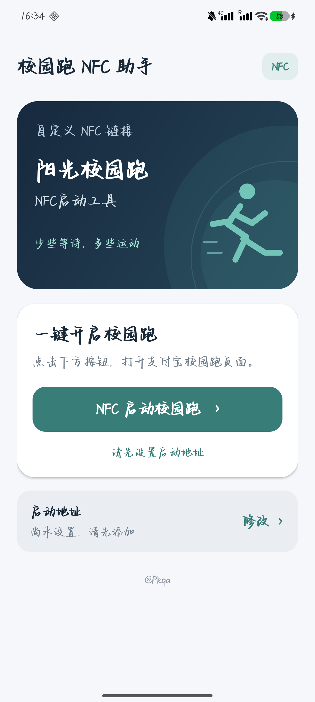

# 校园跑 NFC 助手

**少些等待，多些运动。**

碰卡点人一多，排队、拥挤、反复寻找手机感应位置，往往比想象中更浪费时间。因此做了这个小工具：把自己使用的 NFC 启动链接保存在手机里，需要时点一下，快速打开支付宝中的校园跑页面，把时间留给运动。

  <a href="https://github.com/GloryPkqa/campus-run-nfc/releases/latest">下载正式版 APK</a> ·
  <a href="docs/get-link.md">获取 NFC 链接教程</a> ·
  <a href="docs/school-edition.md">制作自己学校的版本</a> ·
  <a href="docs/build.md">从源码构建</a>

## 能做什么

- 自己填写、保存、修改或清空启动链接；公开版**没有预置任何学校或个人的链接**。
- 一键向支付宝发送包含网址记录与应用记录的 Android NDEF 消息。
- 蓝绿配色、跑步插画；底部 `@Pkqa` 可点击进入本项目。
- 不需要 Root，不申请定位、短信、辅助功能或网络权限；没有广告和统计 SDK。

该工具发送的是软件消息，不会产生真实 NFC 射频信号。能否进入目标页面、能否开始运动，以手机、支付宝版本和业务页面的实际结果为准；它不适用于所有 NFC 标签或所有校园跑平台。

## 安装和使用

1. 在 [Releases](https://github.com/GloryPkqa/campus-run-nfc/releases/latest) 下载 `campus-run-nfc-v1.1.0.apk`，安装到 Android 手机。
2. 打开 App，点击“启动地址 → 修改”。首次点击启动按钮也会打开地址设置。
3. 粘贴从 NFC 标签中读取的**完整 URI/URL**并保存。获取方法见[教程](docs/get-link.md)。
4. 点击“NFC 启动校园跑”，在支付宝页面继续操作。

支持 Android 6.0 及以上；手机需要安装支付宝。安装 APK 时，如系统要求，请只为本次使用的安装来源开放安装权限。

## 为什么普通网页链接与 NFC 消息可能不同

浏览器通常发送 `ACTION_VIEW`。本项目使用 `ACTION_NDEF_DISCOVERED`，附带两条 NDEF 记录，并限定交给支付宝包 `com.eg.android.AlipayGphone`。接收应用可能对两种入口作不同处理。

代码不调用 `su`，不注入系统服务，也不包含伪造的 `Tag` 连接。手机已经 Root 并不是本项目的运行条件。仅“成功发送”也不等于目标业务已经完成。

## 获取链接与学校版本

- [用 NFC Tools / NXP TagInfo 读取完整链接](docs/get-link.md)
- [修改校名、App 名、图标、包名，发布学校版本](docs/school-edition.md)
- [Windows / Linux 构建和签名说明](docs/build.md)

## 作者与使用许可

作者：**[@Pkqa](https://github.com/GloryPkqa)**。原项目：<https://github.com/GloryPkqa/campus-run-nfc>。

欢迎为自己的学校制作版本。发布衍生 App 时，**必须保留界面上可见的 `@Pkqa` 署名、点击前往原项目的链接，以及源码中的版权和许可说明**；可以另加学校维护者的署名。

项目采用 [Pkqa Attribution License 1.0](LICENSE)，这是附带界面署名要求的自定义许可，不是标准 MIT 许可。具体条件以 LICENSE 为准。
